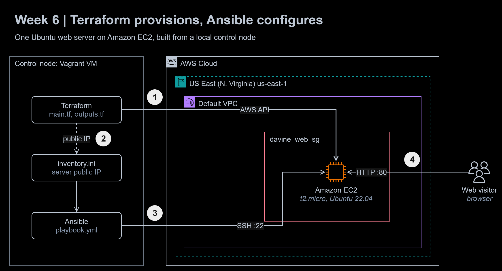
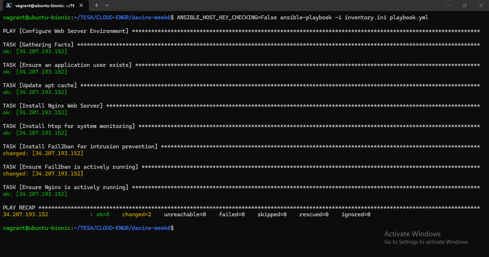

# Terraform and Ansible: a Web Server on AWS


**Lab date:** September 2026 | **Type:** Davine Technologies Internship Project, DevOps internship week 6 lab | **Status:** complete; the server was destroyed after the lab (account checked on 13 November 2026: no instance, key pair or security group left)

> **Evaluation project.** A learning task completed for the Davine Technologies internship programme. One public test server ran briefly in my own AWS account. It is not a production deployment and contains no company data.

**At a glance**

- **Outcome:** one command builds a web server on AWS and a second configures it, so the server can be rebuilt identically instead of set up by hand.
- **Built:** Terraform for an SSH key pair, a security group and an EC2 instance from Canonical's latest Ubuntu 22.04 image, with its public IP as an output; an Ansible inventory and a 7-task playbook (app user, Nginx, htop, Fail2ban); 26 screenshots.
- **Stack:** Terraform (AWS provider 5.x), Ansible, Amazon EC2, Ubuntu 22.04, Nginx, Fail2ban, Vagrant.
- **Proof:** the first playbook run reported `ok=4 changed=2`. After I extended the playbook, a re-run reported `ok=8 changed=2`: only the two new Fail2ban tasks changed and every earlier task reported `ok`, which shows the playbook is idempotent. The Nginx welcome page then loaded over HTTP.



To zoom in, right-click the diagram and open the image in a new tab. The editable source is [`docs/diagrams/terraform-ansible-web-server.drawio`](docs/diagrams/terraform-ansible-web-server.drawio).

1. **Terraform** calls the AWS API: it registers my public SSH key, creates the security group `davine_web_sg` (SSH 22 and HTTP 80 in, all traffic out) and launches a `t2.micro` **EC2** instance in the default VPC.
2. The `server_public_ip` output goes into **`inventory.ini`**.
3. **Ansible** connects over SSH on port 22 with that key and runs `playbook.yml`.
4. A **web visitor** loads the Nginx page on port 80.

## The task, in my own words

Provision a server with infrastructure as code rather than the console, then configure it with a configuration management tool rather than by logging in and typing commands, so that both steps are repeatable and reviewable. Prove it by serving a web page.

## What I did in the lab

**Provisioning with Terraform.** I wrote [`main.tf`](main.tf) (provider, key pair, an AMI lookup filtered to Canonical's account, the security group and the instance), [`variables.tf`](variables.tf) and [`outputs.tf`](outputs.tf), then ran `init`, `validate`, `plan` and `apply`.


More: [init](Screenshots/terraform-init-success.png), [validate](Screenshots/terraform-validate-success.png), [plan part 1](Screenshots/terraform-plan-output-part1.png) and [part 2](Screenshots/terraform-plan-output-part2.png), [state before apply](Screenshots/terraform-empty-tfstate.png) and [after](Screenshots/terraform-tfstate.png), and `terraform show` parts [1](Screenshots/terraform-show-output-part1.png), [2](Screenshots/terraform-show-output-part2.png), [3](Screenshots/terraform-show-output-part3.png), [4](Screenshots/terraform-show-output-part4.png), [5](Screenshots/terraform-show-output-part5.png) and [6](Screenshots/terraform-show-output-part6.png).

**Configuration with Ansible.** I put the server's address in [`inventory.ini`](inventory.ini), checked the connection with `ansible -m ping`, and ran [`playbook.yml`](playbook.yml). The first version installed and started Nginx. I then added a dedicated `app_user`, htop and Fail2ban, and ran it again.



More: [ping](Screenshots/ansible-ping-success.png), [first playbook run](Screenshots/ansible-playbook-execution.png), [user creation run](Screenshots/ansible-playbook-user-creation.png), [inventory](Screenshots/ansible-inventory-ini.png), [playbook](Screenshots/ansible-playbook-yml.png).

**Verification.** The instance ran in the EC2 console with the expected security group rules, and the Nginx welcome page loaded from the public IP.


More: [instance running](Screenshots/aws-ec2-instance-running.png), [security group rules](Screenshots/aws-ec2-security-group-rules.png).

## Running it

```bash
ssh-keygen -t ed25519 -f ~/.ssh/davine_key           # main.tf reads ~/.ssh/davine_key.pub
terraform init && terraform apply                     # note the server_public_ip output
# put that address in inventory.ini, then:
ansible -i inventory.ini webservers -m ping
ansible-playbook -i inventory.ini playbook.yml
terraform destroy                                     # when finished
```

## How it is tested

| Check | What it shows | Result |
|---|---|---|
| `terraform validate` and `plan` | the configuration is valid and creates only what it should | passed, [screenshot](Screenshots/terraform-validate-success.png) |
| `ansible -m ping` | Ansible can reach the server and run Python on it | succeeded, [screenshot](Screenshots/ansible-ping-success.png) |
| Playbook re-run | idempotency: tasks already done report `ok`, not `changed` | `ok=8 changed=2`, only the new Fail2ban tasks changed |
| Browser on port 80 | the security group, the instance and Nginx all work together | welcome page loaded |

## Mistakes I fixed

1. **The server's real public IP was committed** in `inventory.ini`. It belonged to a lab instance that no longer exists, so nothing was exposed, but addresses do not belong in a repository. The file now holds a documentation address (`203.0.113.10`) and a comment saying where the real one comes from.
2. **The first README overstated the hardening.** It called the playbook "server hardening"; it installs Fail2ban and creates a user, which is a start, not hardening. It also called the inventory "dynamic/static"; it is static. Both are now described as they are.
3. **The company name was misspelled** as "Davine Technology". It is Davine Technologies.

## Lab vs production

| Concern | In this lab | Before going to production | Well-Architected pillar |
|---|---|---|---|
| SSH access | port 22 open to `0.0.0.0/0` | no inbound SSH: Systems Manager Session Manager, or SSH from one admin CIDR only | Security |
| Host key checking | turned off with `ANSIBLE_HOST_KEY_CHECKING=False` | left on, with the host key recorded at provisioning time | Security |
| Terraform state | a local `terraform.tfstate` | remote state in S3 with locking, encrypted | Reliability |
| Provider and lock file | provider `~> 5.0`, no `.terraform.lock.hcl` committed | lock file committed, so every run uses the same provider build | Operational Excellence |
| Network | default VPC, public subnet | a dedicated VPC, the server in a private subnet behind a load balancer | Security |
| Instance | one `t2.micro`, no IMDSv2 requirement, default root volume | current-generation type (`t3` or `t4g`), IMDSv2 required, encrypted volume, an Auto Scaling group across two AZs | Reliability |
| HTTP | plain HTTP on port 80 | HTTPS with a certificate from ACM on the load balancer | Security |
| Cost | instance destroyed after the lab | budgets and tags on every resource, schedules for non-production | Cost Optimization |

## What I learned

- **Terraform and Ansible do different jobs.** Terraform decides what exists; Ansible decides how it is configured. Using each for its own job keeps both simple.
- **Idempotency is the test of a good playbook.** Running it twice should change nothing the second time, and the `ok=8 changed=2` re-run is that proof.
- **An output is an interface.** `server_public_ip` is the hand-off between the two tools; next time I would generate the inventory from it instead of copying it.
- **Every open port is a decision.** The lab's `0.0.0.0/0` on SSH is the first thing I would change.

## License

Released under the [MIT License](LICENSE).
