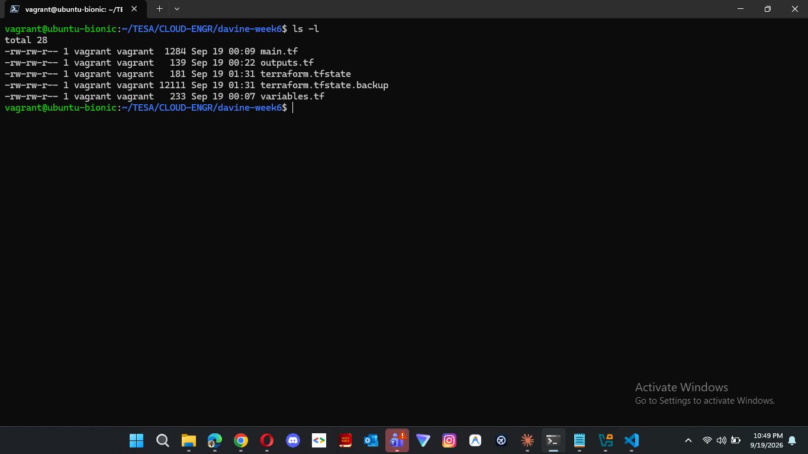
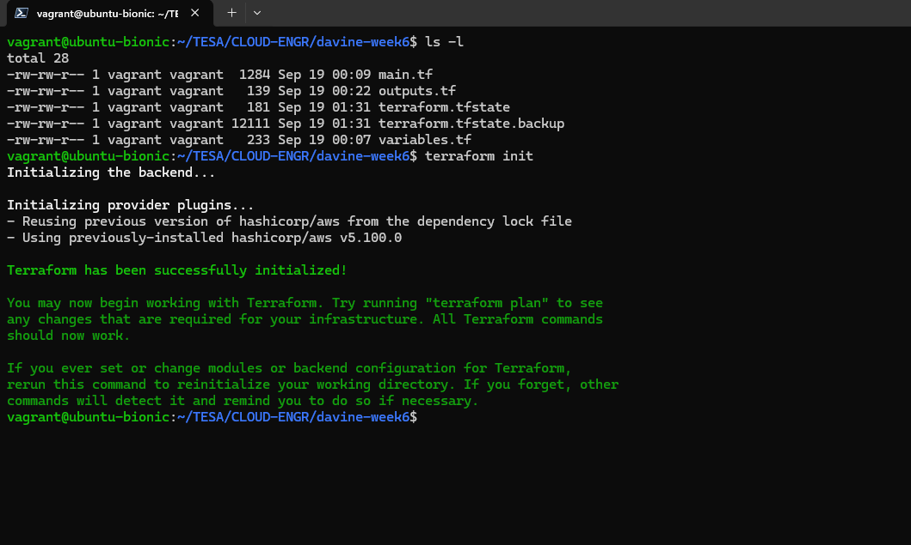
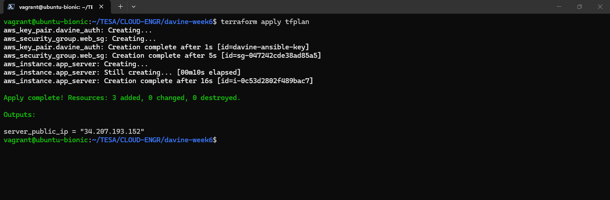
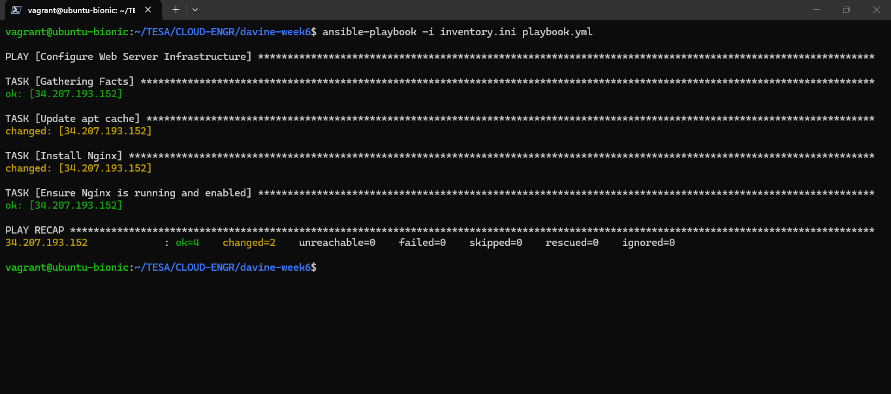
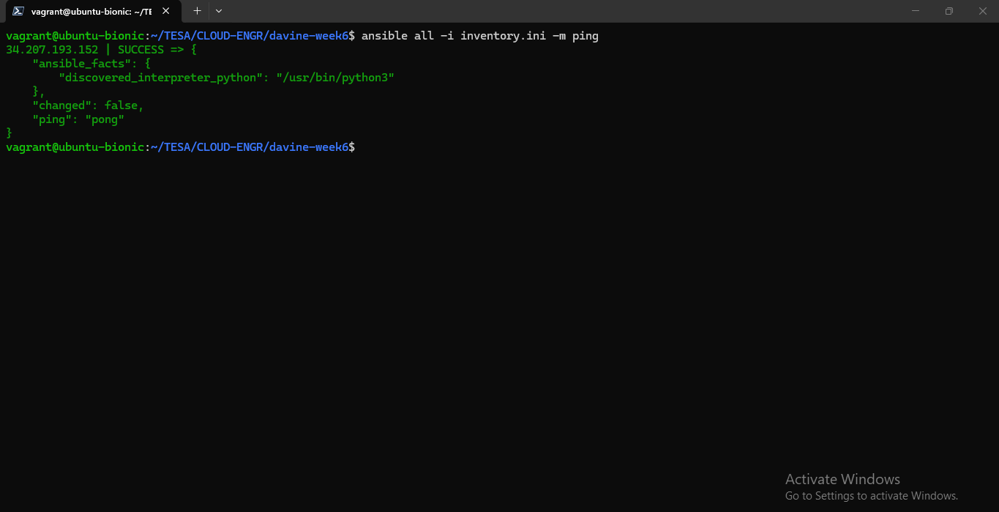
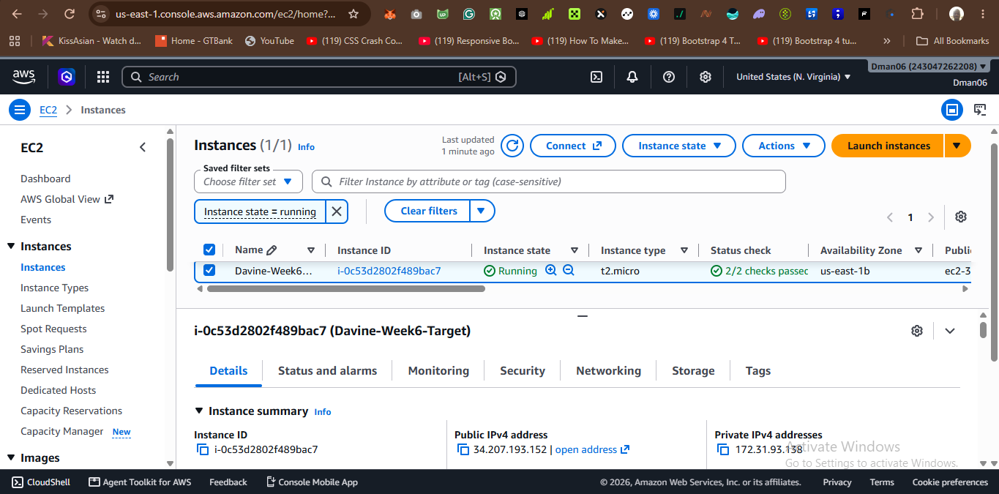
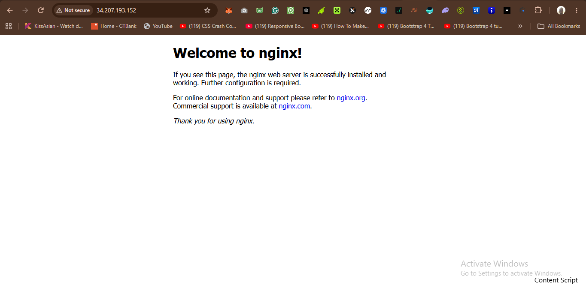

# Infrastructure as Code (IaC) & Configuration Management

## Overview
This repository contains the code and configuration for automating the provisioning and configuration of a cloud-based Web Server infrastructure. 

The project leverages **Terraform** for Infrastructure as Code (IaC) to spin up compute resources on AWS, and **Ansible** for Configuration Management to handle software installation and server hardening. This achieves a fully automated, reproducible, and scalable infrastructure deployment.

## Technology Stack
*   **Cloud Provider:** AWS (Amazon Web Services)
*   **Infrastructure Provisioning:** Terraform
*   **Configuration Management:** Ansible
*   **Operating System:** Ubuntu 22.04 LTS
*   **Web Server:** Nginx
*   **Security & Monitoring:** Fail2ban, htop

---

## Architecture and Workflow

### 1. Infrastructure Provisioning (Terraform)
Terraform is used to define and provision the underlying AWS infrastructure. The configuration creates an EC2 instance in the default VPC and configures security groups to allow HTTP and SSH traffic.

- **`main.tf`**: Defines the AWS provider, EC2 instance (`t2.micro`), SSH Key pair association, and Security Groups allowing inbound access on ports 22 (SSH) and 80 (HTTP).
- **`variables.tf`**: Defines input variables such as the AWS region and instance type, making the configuration modular.
- **`outputs.tf`**: Extracts critical resulting information, such as the `server_public_ip`, which is then passed to Ansible.

#### Terraform Execution

### 2. Configuration Management (Ansible)
Once Terraform successfully provisions the infrastructure and outputs the public IP address, Ansible takes over to configure the operating system and run the required services.

- **`inventory.ini`**: A dynamic/static list containing the public IP address of the provisioned EC2 instance, enabling Ansible to establish an SSH connection.
- **`playbook.yml`**: A declarative YAML file that automates the following tasks on the newly created server:
  - System package updates.
  - Creating a dedicated application user.
  - Installing and starting the **Nginx** web server.
  - Installing **htop** for system monitoring.
  - Installing and enabling **Fail2ban** for intrusion prevention and SSH protection.

#### Ansible Execution

### 3. Verification
The end result is a fully functional web server accessible over the public internet, successfully demonstrating end-to-end infrastructure automation.

---
**Author:** Oseni Sakariyau Oluwadamilare (Dami)  
**Role:** DevOps Engineering Intern @ Davine Technology
